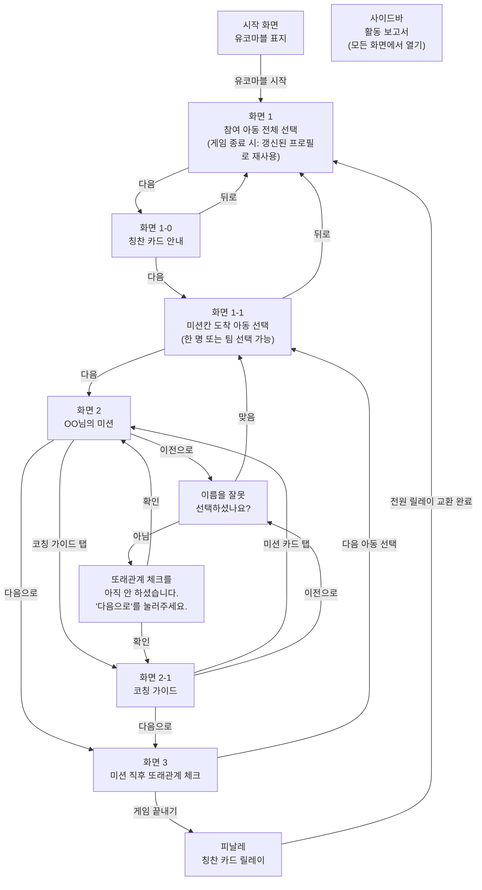

# PRD — 짝꿍 미션 카드 만들기
- 상태 : 완성
- 한 줄 정의 : 지역아동센터 대학생 멘토가, 아이의 성향과 기피 이력을 체크하면 맞춤형 짝꿍 미션과 코칭 가이드가 나와, 현장에서 고민 없이 또래 상호작용을 이끌어내고 1초 피드백으로 즉시 반영하는 서비스
- 함께 쓰는 보드게임 : 유코마블 — 아이들이 판 위에서 말을 움직이는 다문화 보드게임이다. 아이가 '미션칸'에 도착하면 멘토가 휴대폰의 짝꿍 미션 카드 앱으로 그 아이에게 맞는 미션을 꺼낸다. 보드게임은 오프라인에서, 미션 추천과 기록은 멘토의 휴대폰에서 이루어지며, 미션 보상은 유코마블 속 돈으로 받는다.

## 1. 문제

### 배경
- 지역아동센터나 늘봄학교에서 다문화·취약계층 아동이나 친구들과 잘 어울리지 못하는 아동이, 다른 친구들과 보드게임 등을 하며 놀 때 멘토가 아이의 정서 성향이나 기피 특성에 맞는 미션과 소통 방식을 몰라서 당장 어떻게 해야 할지 모른다.
- 부담스러운 단독 발표나 긴 설명 미션을 강요했다가, 아이가 거부감을 보이거나 이탈할까 봐 불안하다.
- 지금은 체계적인 프로그램 없이 숙제를 봐주거나 단순 놀이, 옆에 있어주는 수준에 머물고 있고, 아이가 미션을 주저하거나 기피하면 임기응변이나 직관으로 다른 카드를 뽑게 한다.
- 멘토링으로 정서나 또래 관계가 얼마나 좋아졌는지 객관적 데이터로 입증할 수 없어, 회기 종료 후에는 소감문이나 만족도 설문지로 성과 보고를 대신하고 있다.

### 목표
- 멘토가 아이 성향에 맞는 미션과 코칭 가이드를 즉시 확인하고, 미션 직후 1초 피드백으로 바로 다음 미션에 반영해, 현장에서 고민 없이 또래 상호작용을 이끌어낸다.

## 2. 사용자

### 페르소나
- 누구 : 지역아동센터나 늘봄학교에서 다문화·취약계층 아동을 대상으로 멘토링하는 대학생 멘토
- 언제 쓰는가 : 아동이 다른 친구들과 보드게임 등을 하며 놀 때, 그리고 멘토링 회기가 끝나고 기관·장학재단에 낼 활동 보고서를 작성할 때
- 지금 겪는 어려움 : 아이 성향에 맞는 미션·소통 방식을 몰라 당장 어떻게 해야 할지 모르고, 성과를 정량적으로 입증하지 못한다
- 참고 : 아동(피멘토)이 직접 쓰는 경우는 이번 서비스의 주 사용자가 아니다. 아동이 쓴다면 멘토용 코칭 가이드·보고서 화면은 숨겨지고 게임 플레이 화면만 보여야 하므로, 이번 범위에서는 아동용 화면을 만들지 않는다(비목표 참고).

### 사용자 스토리
- 대학생 멘토로서, 미션칸 도착 아동을 선택했을 때 그 아이에게 맞는 짝꿍 미션 카드를 바로 보고 싶다. 아이의 성향에 맞는 미션을 몰라서 당장 어떻게 해야 할지 모르기 때문이다.
- 대학생 멘토로서, 미션 카드를 본 뒤 코칭 가이드도 바로 보고 싶다. 아이에게 어떤 말과 행동으로 다가가야 할지 몰라서 당장 어떻게 해야 할지 모르기 때문이다.
- 대학생 멘토로서, 미션 직후 1초 만에 좋음/보통/기피 반응을 기록하고 싶다. 현장에서 바로 다음 미션에 반영하고, 그 반응이 또래관계 데이터로 쌓이길 원하기 때문이다.

## 3. 범위

### 넣을 기능
1. 아동 성향 태그 맞춤 짝꿍 미션 카드 추천 (핵심)
2. 미션 카드에 맞는 멘토 코칭 가이드 출력
3. 미션 수행 직후 멘토 전용 1초 반응(좋음/보통/기피) 피드백 버튼
4. 지구별 링키 챗봇 — [서비스 문의]와 [미션 카드 만들기] 메뉴로, 나라·의식주·문화 요소를 넣으면 AI가 이번 미션에 맞는 미션 카드를 만들어 화면 2 카드를 바로 바꾼다
5. 피날레 칭찬 카드 릴레이 — 게임을 끝낼 때 아이들이 미리 써 둔 칭찬 카드를 한 바퀴 돌며 서로 건넨다
6. 활동 보고서 — 사이드바에서 회기별 또는 기간별로 범위를 고르고 아동을 고르면(비우면 전체, 1명이면 개인, 여러 명이면 관계), 아동별 또래관계 반응 변화 그래프, 회귀 분석 등 정량 지표, 핵심 요약, 지도 코칭, 멘토가 고칠 수 있는 보고서 초안을 만들고 PDF 또는 Word로 내려받는다

### 기능 요구사항
- 미션칸에 도착한 아동을 한 명 또는 여러 명(팀)으로 선택하면, 짝/팀 구성에 맞는 [짝꿍 미션 카드]가 나오고 하단 [코칭 가이드] 탭을 누르면 멘토 전용 행동 지침 문구가 나온다.
- 화면 2의 미션 구성은 같은 팀으로 도착한 아동끼리 서로 경쟁하는 편으로 나뉘지 않는다는 전제 아래, 오늘 전체 참여 아동(화면 1) 중 도착 아동이 아닌 인원에서만 미션 참여 횟수가 적은 아동을 우선으로 랜덤으로 뽑아, 도착 아동 중 한 명만 참여하는 개인 미션, 도착 팀끼리만 하는 합동 미션, 도착 팀에 다른 아동이 합류해 함께하는 합동 미션, 또는 상대 인원 수에 따라 1:1/2:1/2:2/1:3/3:1 등 다양한 비율의 경쟁 미션 중 하나로 구성된다.
- 팀으로 도착하면 팀 미션(합동·경쟁)을 우선으로 구성하고, 개인 미션은 드물게(약 10%) 나온다. 그 인원으로 꾸릴 수 있는 팀 미션이 없으면 개인 미션으로 구성한다.
- 팀 도착에 개인 미션이 나오면, 앱이 할 아동 한 명을 지정해 화면 2에 "이번 미션은 OO 차례입니다"로 보여 준다. 아동끼리 서로 하겠다고 다투지 않게 하려는 것이며, 나머지 도착 아동은 응원 역할을 맡는다.

- 이 랜덤 매칭 기준(참여 횟수 우선순위)은 멘토 화면에 안내 문구로 노출하지 않는다.
- 화면 1-1에서는 아동별 누적 미션 참여 횟수가 함께 표시되어, 멘토가 도착 아동을 고를 때 참고할 수 있다.
- 미션 직후 [좋음]/[보통]/[기피] 버튼 중 하나를 누르고 추가로 메모 기능을 활용할 수 있다. 이번 짝/팀과의 또래관계 반응과 메모(선택사항), 몇 번째 게임인지(회차)가 Supabase reactions 표에 저장된다. 그 다음 [다음 아동 선택]을 누르면 미션 칸에 도착한 아동을 선택하는 화면(화면 1-1)으로 전환된다.
- 링키 챗봇의 [미션 카드 만들기]에서 나라를 적고(여러 나라는 쉼표로, 영어·그 나라 말·띄어쓰기·오타도 어느 나라인지 알아보면 허용) 의식주·문화 요소(전통놀이·음식·인사말·옷·집·명절)를 체크하거나 기타에 적어 [AI 미션 카드 만들기]를 누르면, AI가 만든 카드가 화면 2의 짝꿍 미션 카드를 바로 바꾸고 화면 2-1 코칭 가이드와 Supabase 기록에도 그 카드가 쓰인다. 실제로 없는 나라면 만들지 않는다.
- AI 미션 카드는 게임 한 판에 5번까지 만들 수 있다.
- 화면에 쓴 AI 미션 카드는 미션 종류(mission_type)와 문화 요소(culture)가 Supabase ai_missions 표에 기록된다.
- 모든 짝꿍 미션 카드에는 난이도와 보상(보드게임 속 돈: 쉬움 5천원 / 보통 1만원·2만원·3만원 / 어려움 5만원)이 함께 보인다.
- 미션에는 색종이·A4 종이·펜·가위처럼 센터에 늘 있는 물건만 쓰고, 따로 구해야 하는 물건이 필요한 미션은 넣지 않는다.
- 챗봇 답과 미션 카드는 전체 이용가로 쓰고, '파트너'처럼 다르게 들릴 수 있는 말, 성적인 내용·욕설·폭력·서로 다투는 내용은 넣지 않는다.
- 챗봇 세계관 : 챗봇 '링키(Linky)'는 지구별에서 온 지구본 모양 요원으로, Play-Link의 핵심인 '연결(Link)'과 '짝꿍 미션'을 이어 준다. 챗봇 답도 이 세계관에 맞는 밝고 다정한 말투로 한다.
- AI 미션 카드의 음식은 종교에 따른 제한(이슬람교: 할랄 음식만·돼지고기 X / 힌두교: 소고기 X)을 지키고 술은 쓰지 않는다. 민감한 역사·영토·종교 논쟁과 나라 비교·고정관념은 넣지 않으며, 문화 이름·글자·유래는 널리 확인된 사실만 쓰고 그 나라 말은 원어 글자를 함께 적는다.
- 챗봇은 서비스 내용(기능·화면·규칙·범위)을 PRD에 적힌 것만 근거로 답하고, PRD에 없는 서비스 내용은 지어내지 않고 '아직 정해지지 않은 내용이에요'라고 답한다. 멘토가 아이를 대하는 방법을 물으면 따뜻하고 교육적인 조언을 직접 해 주되, 폭력적이거나 교육에 어긋나는 방법(때리기·벌주기·겁주기·창피 주기 등)은 절대 권하지 않는다.
- 챗봇 [서비스 문의]는 멘토 한 명당 하루 10번까지 물어볼 수 있다.
- 링키 챗봇 [서비스 문의]에서 물은 말과 받은 답은 Supabase chat_logs 표에 저장되고(아동 이름은 child_id로 바꿔 저장), 대화창 아래 [지난 대화 목록]에서 볼 수 있다. 로그인이 없는 지금은 모든 멘토의 대화가 한 표에 쌓이므로 최근 20개만 보여 준다.
- 화면 2·2-1 오른쪽 위 [스킵]을 누르면 [시간초과]·[룰 미숙지]·[단순패스] 칩이 나오고, 하나를 누르면 Supabase reactions 표에 스킵 기록(feedback_type 'skip', skip_reason 'timeout'·'rule_unfamiliar'·'flow_pass', 미션 카드가 뜬 뒤 걸린 초 response_latency)이 남는다. 시간초과는 화면 1-1로, 룰 미숙지는 같은 아이들에게 더 쉬운 미션으로, 단순패스는 다른 미션으로 바로 이어지며, 스킵한 미션은 "미션 N회"를 늘리지 않는다.
- 화면 3 메모에 적은 아동 이름은 저장할 때 child_id로 바꿔, Supabase에는 실명을 남기지 않는다.
- 화면 1에서 [다음]을 누르면 화면 1-0 칭찬 카드 안내가 나와, 아이들이 유코마블 무지 카드에 친구를 위한 그림과 칭찬 한 줄을 미리 쓴다. 칭찬 카드의 게임 내 보상은 유코 화폐 1만원으로 통일한다.
- 피날레 칭찬 카드 릴레이 : 화면 3에서 [게임 끝내기]를 누르면 피날레 화면이 나와, 오늘 참여한 아동을 무작위 순서로 한 바퀴 이어(마지막 아동은 첫 아동에게) 누구나 칭찬 카드를 1장 주고 1장 받는다. 머뭇거린 아동 체크 칸은 아이들이 보지 않게 [멘토 메모]를 눌렀을 때만 펼쳐진다. [전원 릴레이 교환 완료]를 누르면 회차·참여 아동 수·릴레이 순서·머뭇거린 아동(child_id)·교환까지 걸린 초가 Supabase finale_passes 표에 저장되고 화면 1로 간다.
- 활동 보고서 : 화면 왼쪽 사이드바에서 언제든 [회기별] 또는 [기간별]을 고른다. [회기별]은 Supabase에 기록이 있는 회차 중 시작 회차와 끝 회차(예: 1차, 또는 2차~5차)를 슬라이더로 끌거나 [시작 회차]·[끝 회차] 칸에 직접 적고, [기간별]은 시작일·끝일(예: 한 달)을 달력에서 고르거나 [직접 입력] 칸에 2026/11/01~2026/11/10처럼 적는다. [멘토링 보고서 제작]을 누르면, 고른 범위의 Supabase reactions·finale_passes 기록만으로 아동별 반응(좋음/보통/기피) 변화 그래프, 정량 분석, 핵심 요약(반응·스킵·메모·피날레), 지도 코칭, 글자를 고칠 수 있는 보고서 초안 칸이 본문에 나온다. 보고서 제목 바로 아래 [기간] 띠에는 회차 범위와 그 회차들이 열린 날짜(첫 기록 ~ 마지막 기록, 요일)와 활동일 수를 함께 보여 준다 (예: 1차~6차 · 2026.10.14(수) ~ 2026.10.22(목) · 활동일 3일). PDF·Word에도 같은 기간이 들어간다.
- 보고서 문체 : 핵심 요약과 보고서에 들어가는 지도 코칭은 기관·장학재단에 내는 멘토링 활동 보고서 문체(합니다체)로 쓴다. 좋아진 점은 '~을 통해 ~가 개선되었습니다', 부족한 점은 '~이 필요합니다/~해야 합니다', 다음 회기 계획은 '~할 예정입니다'로 쓰고, '개선되었습니다'는 정량 지표에 좋아진 근거(유의미한 상승, 2번 이상 함께한 양의 시너지 등)가 있을 때만 쓴다.
- 지도 코칭은 두 가지로 둔다. 화면 [지도 코칭] 탭은 멘토가 현장에서 보는 해요체 권유("~해 보세요")로, 보고서 편집 탭·PDF·Word에 들어가는 지도 코칭은 위 보고서 문체(합니다체)로 쓴다.
- 보고서 아동 선택 : 사이드바 [아동 선택] 칸에서 이름을 검색해 여러 명을 고를 수 있다. 비우면 전체 보고서, 1명이면 개인 리포트(참여 미션 수, 평균 반응 점수, 좋음·기피 비율, 회차별 추세의 기울기·p값, 스킵·피날레 머뭇거림, 미션 종류별·함께한 친구별 평균)와 개인 맞춤 지도 코칭, 2명 이상(AB, ABC, ABDE 등)이면 고른 아동끼리의 관계 리포트(짝별 함께한 횟수·함께 평균·각자 평균·시너지, 따로 할 때와 함께할 때 비교)와 관계 맞춤 지도 코칭이 나온다.
- 보고서 정량 분석 : 반응 점수(좋음 2 · 보통 1 · 기피 0)로 아동별 회차 추세 단순 선형 회귀(기록 4건 이상), 회차·미션 종류·난이도·성향을 넣은 다중 회귀, 함께한 두 아동의 관계 히트맵, 성향별 평균을 꺾은선·막대·히트맵 그래프와 함께 보여 주고, p < 0.05 만 '유의미'라고 쓴다. 미션 종류와 거의 겹치는 변수(난이도 등)는 다중 회귀에서 빼고 그 이유를 화면에 적는다.
- 보고서 편집 : [보고서 편집] 탭에서 제목·핵심 요약·지도 코칭·보고서 본문을 고친 뒤 [PDF로 내려받기] 또는 [Word로 내려받기(.docx)]를 누르면, 고친 글과 그래프가 담긴 파일이 내려받아진다. 보고서 화면은 넓게 펼치고 탭(한눈에·그래프·지도 코칭·보고서 편집 등)으로 나눠 보여 준다.
- [멘토링 보고서 제작] 버튼은 언제든 누를 수 있지만, 게임이 진행 중일 때(화면 1-0~화면 3)는 [게임 끝내기]를 누르기 전까지 잠기고, 진행 중인 회차는 [회기별]·[기간별] 범위에 들어가지 않는다.
- 보고서의 AI 요약과 초안을 만들 때는 아동을 child_id로만 보내고, 화면과 PDF에 보여 줄 때만 child_id(메모 속 child_id 포함)를 실명으로 바꾼다. 보고서용 Supabase 표는 새로 만들지 않는다.

### 비목표
- 아동 기기용 게임 화면 및 아동 전용 인터페이스 — 1차 MVP는 멘토 1인의 코칭/피드백 단독 흐름에 집중하며, 아동에게 평가 지표가 노출되지 않도록 완전 분리한다.
- 회원가입 및 로그인 계정 관리 — 1차 MVP는 멘토 1인이 화면 1~3의 미션 추천·피드백 흐름을 확인하는 데 집중하므로, 로그인 없이도 이 흐름을 그대로 검증할 수 있다. 추후 로그인이 생기면 [지난 대화 목록]에서 최근 20개가 아니라 멘토 본인의 챗봇 대화 전체 기록을 볼 수 있게 한다. (추후 고도화)
- 여러 기기 간 실시간 게임 화면 동기화 — 보드게임은 한 자리에 모여 진행되고 멘토가 혼자 화면을 보며 기록하는 방식이라, 기기 간 동기화 없이도 화면 1~3 흐름에 지장이 없다.
- 기피 이력 자동 우회 추천 알고리즘 — 없어도 한 회기 동안 미션을 추천받고 1초 피드백을 입력하는 데 지장이 없다.
- 아동 성향·기피 이력 체크리스트와 아동 프로필 저장 화면 — 다문화 아동의 부모 국적(아빠 또는 엄마 국적이 한국이 아닌 경우)과 종교(음식 제한)도 함께 기록할 예정이며, 아직 화면으로 만들지 않았다. (추후 고도화)
- 아동 명단·미션 카드의 온라인 저장 — 아동 명단과 미션 카드는 지금처럼 CSV 파일로 두고, 온라인에는 반응·스킵 기록, 챗봇 대화 기록, AI 미션 카드 기록, 피날레 칭찬 카드 릴레이 기록만 쌓는다. 바뀔 일이 적어 CSV로도 한 회기 흐름에 지장이 없다. 화면 1 [+ 이름 추가]로 넣은 아동은 children.csv에 명단 다음 번호(C08 다음이면 C09)로 이어 적어, 다른 날 보고서에서도 실명으로 보인다.
- 미션 참여 횟수, AI 미션 카드 횟수, 챗봇 문의 횟수는 브라우저 메모리에만 두고 새로고침하면 초기화된다.
- 태블릿 화면 최적화 — 1차 MVP는 멘토가 현장에서 한 손으로 드는 휴대폰 세로 화면을 기준으로 만들고, 태블릿 버전은 추후 만든다.

## 4. 화면

### 사용자 흐름
- 시작 화면 — 유코마블 표지 : 앱을 열면 유코마블 사용설명서 표지 느낌(하늘색 배경, START·FOOD·GAME·FINISH 보드판 칸 테두리, 나라별 그림, '유코마블' 제목, 'for. 다문화 감수성 강화 놀이')의 화면이 먼저 나오고, [유코마블 시작]을 누르면 화면 1로 간다.
- 화면 1 — 참여 아동 전체 선택 : 오늘 같이 게임하는 아동 전체를 다중 선택한다. (게임 끝내기 시 같은 틀을 재사용해 방금 그 아동의 갱신된 프로필을 보여준다)
- 화면 1-0 — 칭찬 카드 안내 : 아이들이 유코마블 무지 카드에 친구에게 줄 그림과 칭찬 한 줄을 쓴다. [다음]을 누르면 화면 1-1로 간다.
- 화면 1-1 — 미션칸 도착 아동 선택 : 화면 1에서 고른 아동 중 미션 칸에 도착한 아동을 한 명 또는 여러 명(팀) 선택한다. 아동 이름 옆에 "미션 N회" 참여 횟수가 함께 보인다.
- 화면 2 — OO님의 미션 : 개인 미션, 합동 미션(도착 팀끼리 또는 다른 아동 합류), 경쟁 미션(1:1/2:1/2:2/1:3/3:1 등) 중 하나로 구성된 [짝꿍 미션 카드] 1장이 나온다.
- 화면 2-1 — 코칭 가이드 : 멘토가 현장에서 바로 활용할 행동 지침 문구가 나온다.
- 화면 3 — 미션 직후 또래관계 체크 : 멘토가 미션 직후 [좋음]/[보통]/[기피] 버튼 중 하나를 판단해 고르면, 이번 짝/팀과의 또래관계 반응이 Supabase reactions 표에 저장된다. 이때 메모를 덧붙일 수 있다. 그 다음 [다음 아동 선택]을 누르면 화면 1-1로 전환된다.
- 피날레 — 피날레 칭찬 카드 릴레이 : [게임 끝내기]를 누르면 나온다. 릴레이 순서("아동 A → 아동 B")가 크게 보이고, [전원 릴레이 교환 완료]를 누르면 화면 1로 간다.
- 팝업 1 — 이름 확인 : 화면 2·2-1에서 [이전으로]를 누르면, 아동을 잘못 선택했는지 확인한다.
- 팝업 2 — 또래관계 체크 안내 : 팝업 1에서 [아님]을 누르면, 또래관계 체크를 아직 하지 않았다는 안내가 뜬다.
- 지구별 링키(지구본 모양) 챗봇 : 모든 화면 오른쪽 아래 '링키' 아이콘을 누르면 열린다. [서비스 문의]는 PRD 내용으로 답하고, [미션 카드 만들기]는 화면 2·2-1에서만 쓸 수 있다.
- 사이드바 — 활동 보고서 : 모든 화면 왼쪽 사이드바에서 언제든 연다. [회기별](1차, 2차~5차처럼 회차 범위 — 슬라이더 또는 직접 입력)·[기간별](시작일·끝일 — 달력 또는 직접 입력) 필터와 [아동 선택](검색·여러 명)을 고르고 [멘토링 보고서 제작]을 누르면 본문에 넓은 보고서 화면이 탭으로 나온다. 게임 진행 중에는 [게임 끝내기]를 누르기 전까지 버튼이 잠긴다. 휴대폰에서는 사이드바가 접혀 있어 게임 중 아이들 눈에 띄지 않는다.
- 성향·기피 이력 체크리스트 화면 : 아직 화면으로 만들지 않았고, 추후 고도화 예정이라 이번 흐름에는 없음.

## 5. 완성 기준

### 수용 기준
- 미션칸 도착 아동(1명 또는 팀)을 선택하고 [다음]을 누르면, 그 인원 구성에 맞는 짝꿍 미션 카드가 화면 2에 나온다.

- 화면 1-1에서 도착 아동을 선택해 [다음]을 누르면, 화면 2에 개인 미션·합동 미션·경쟁 미션(1:1/2:1/2:2/1:3/3:1 등) 중 하나로 구성된 미션이 나온다.

- 화면 1-1에서 성향 데이터가 없는 아동을 선택해 [다음]을 누르면, 화면 2에는 보편적 아이스브레이킹 미션 카드가, [코칭 가이드] 탭을 누른 화면 2-1에는 초기 관찰용 코칭 가이드 문구가 나온다.
- 화면 2에서 [코칭 가이드] 탭을 누르면 화면 2-1로 전환되고, [미션 카드] 탭을 누르면 다시 화면 2로 돌아간다.
- 화면 3에서 [좋음]/[보통]/[기피] 중 하나를 누르면, [다음 아동 선택]과 [게임 끝내기] 버튼을 누를 수 있게 바뀐다.
- [다음 아동 선택]을 누르면 화면 1-1로, [게임 끝내기]를 누르면 피날레 화면을 거쳐 화면 1로 이동하며 방금 그 아동(들)의 갱신된 프로필이 반영된다.
- 화면 2 또는 2-1에서 [이전으로]를 누르면 "이름을 잘못 선택하셨나요?" 팝업이 뜨고, [맞음]이면 화면 1-1로 이동, [아님]이면 "또래관계 체크를 아직 안 하셨습니다" 안내가 뜬 뒤 직전 화면(화면 2 또는 2-1)으로 돌아간다.
- 화면 3에서 반응을 기록한 뒤 [다음 아동 선택]을 누르면, 화면 1-1에서 그 아동의 "미션 N회" 숫자가 1 늘어나 있다.

- 팀 도착에 개인 미션이 나온 경우에는 화면 1-1에서 차례로 지정된 아동만 1 늘어나고, 응원한 아동은 그대로다.
- 팀으로 도착한 아동을 선택해 [다음]을 누르면 대부분 팀 미션(합동·경쟁)이 나오고, 개인 미션이 나오면 화면 2에 "이번 미션은 OO 차례입니다" 안내가 함께 나온다.
- 화면 3에서 반응을 기록한 뒤 앱을 새로고침해도, Supabase reactions 표에 그 기록이 남아 있다.
- 화면 2에서 링키 챗봇 [미션 카드 만들기]로 나라와 문화 요소를 넣고 [AI 미션 카드 만들기]를 누르면, 화면 2의 미션 카드가 바로 AI 카드로 바뀌고 보상이 함께 보인다.
- 없는 나라 이름(예: 아틀란티스)을 적으면 미션 카드가 만들어지지 않는다.
- 한 판에 AI 미션 카드를 5번 만들면 [AI 미션 카드 만들기] 버튼이 잠긴다.
- 화면 1에서 [다음]을 누르면 칭찬 카드 안내(화면 1-0)가 나오고, 여기서 [다음]을 누르면 화면 1-1로 간다.
- 화면 3에서 [게임 끝내기]를 누르면 오늘 참여한 아동 모두가 한 번씩 주고 한 번씩 받는 릴레이 순서가 나오고, [전원 릴레이 교환 완료]를 누르면 Supabase finale_passes 표에 기록이 남은 뒤 화면 1로 간다.
- 앱을 열면 유코마블 시작 화면이 먼저 나오고, [유코마블 시작]을 누르면 화면 1로 간다.
- 사이드바에서 [회기별]로 회차 범위(예: 1차, 또는 2차~5차)를, 또는 [기간별]로 시작일·끝일을 정하고 [멘토링 보고서 제작]을 누르면, 고른 범위의 기록만으로 만든 아동별 반응 변화 막대 차트, 핵심 요약, 고칠 수 있는 보고서 초안 칸, [PDF로 내려받기] 버튼이 화면에 보이고, 제목 아래 [기간] 띠에 회차 범위와 날짜(예: 1차~6차 · 2026.10.14(수) ~ 2026.10.22(목))가 함께 보인다.
- 개인·관계 보고서에서 화면 [지도 코칭] 탭에는 "~해 보세요" 말투의 코칭이, [보고서 편집] 탭과 내려받은 PDF·Word에는 "~할 예정입니다" 같은 보고서 문체의 코칭이 들어간다.
- 게임 진행 중(화면 1-0~화면 3)에는 사이드바 [멘토링 보고서 제작] 버튼이 잠겨 있고, 화면 3에서 [게임 끝내기]를 누르면 버튼이 풀리며 방금 끝낸 회차를 고를 수 있다.
- 보고서 초안 칸에서 글을 고친 뒤 [PDF로 내려받기]를 누르면, 고친 글과 차트가 담긴 PDF 파일이 내려받아지고 아동 이름은 실명으로 보인다.
- [보고서 편집] 탭에서 제목·요약·코칭·본문을 고친 뒤 [Word로 내려받기(.docx)]를 누르면, 고친 글과 그래프가 담긴 Word 파일이 내려받아진다.
- 사이드바 [시작 회차]·[끝 회차] 칸에 3과 7을 적으면 회차 슬라이더도 3차~7차로 바뀌고, [직접 입력]에 2026/11/01~2026/11/10처럼 적으면 달력 칸도 그 날짜로 바뀐다.
- 사이드바 [아동 선택]에서 1명을 고르고 [멘토링 보고서 제작]을 누르면 그 아동의 개인 지표·그래프와 개인 맞춤 지도 코칭이, 2명 이상을 고르면 짝별 함께 평균·시너지 등 관계 지표·그래프와 관계 맞춤 지도 코칭이 나온다.
- 보고서 정량 분석에는 아동별 회차 추세 회귀선과 p값, 다중 회귀 계수와 95% 신뢰 구간이 나오고, p < 0.05 인 것만 '유의미'로 표시된다.
- 화면 1에서 [+ 이름 추가]를 누르면 다음 알파벳 이름(예: 아동 I)이 미리 들어 있고, 추가하면 목록에 ABCD 순서로 들어가며 children.csv에 다음 번호(예: C09)로 저장된다.