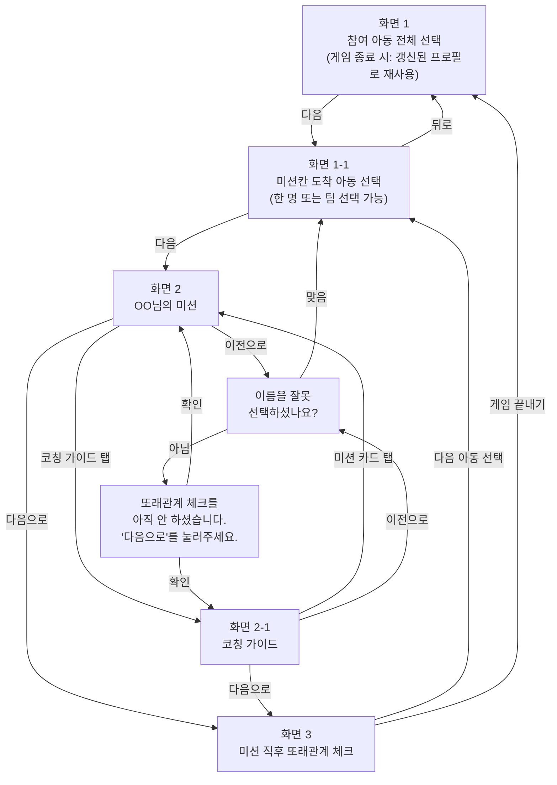

# 서비스 화면 흐름도

# Claude 디자인에서 와이어프레임 그리기 (내가 만듦)

1. Claude Desktop 사이드바의 디자인을 열거나 브라우저에서 `claude.ai/design`홈페이지로 들어갑니다.
2. 입력창 아래 만들 형식 목록에서 [Wireframe] 을 누릅니다. 바로 옆 [UI mockups]는 색과 모양까지 입힌 시안이라 이번에는 고르지 않습니다.
3. 입력창 아래 Design system 칸을 봅니다. 다른 디자인 이름(예: Nocturne)이 골라져 있으면 눌러서 빼 둡니다. 켜져 있으면 뼈대에 그 디자인의 색과 글꼴이 묻어납니다.
4. Step 1에서 받은 요청문을 통째로 복사해 입력창에 붙여넣고 보냅니다.
↓↓↓↓↓↓↓↓↓↓↓↓↓↓↓
Make UI mockups for 아래 서비스의 화면을 와이어프레임으로 그려 주세요.

서비스 : 보드게임 미션 칸 도착 시 아동 이름을 선택하면 → 아이에게 보여줄 맞춤 [짝꿍 미션 카드]가 나온다.

화면 1 - 참여 아동 전체 선택 : 오늘 같이 게임하는 아동들을 다중 선택하는 화면, [다음] 버튼

화면 1-1 - 미션칸 도착 아동 선택 : 고른 아동들 중 미션 칸에 도착한 아동을 한 명 또는 여러 명(팀)으로 다중 선택하는 화면, [다음] 버튼

화면 2 - OO님의 미션 : 1:1 / 1:2 / 2:2 짝·팀으로 구성된 미션 카드가 나오는 화면, [코칭 가이드] 탭 · [다음으로] · [이전으로] 버튼 ([이전으로]를 누르면 아래 "이름 확인" 팝업이 뜸)

화면 2-1 - 코칭 가이드 : 멘토용 행동 지침 문구가 나오는 화면, [다음으로] · [이전으로] 버튼 ([이전으로]를 누르면 아래 "이름 확인" 팝업이 뜸)

화면 3 - 미션 직후 또래관계 체크 : 아동 개인의 기분이 아니라 이번 짝/팀과 잘 어울렸는지를 멘토가 판단하는 [좋음] [보통] [기피] 버튼과, 하단에 [다음 아동 선택] · [게임 끝내기] 버튼이 있는 화면 ([게임 끝내기]를 누르면 화면 1 틀을 재사용해 방금 그 아동(들)의 갱신된 프로필을 보여줌 — 별도의 세션 요약 화면은 없음)

팝업 1 - 이름 확인 : "이름을 잘못 선택하셨나요?" 문구와 [맞음] [아님] 버튼이 있는 작은 화면. [맞음]을 누르면 화면 1-1로 이동, [아님]을 누르면 아래 "또래관계 체크 안내" 팝업으로 이동

팝업 2 - 또래관계 체크 안내 : "또래관계 체크를 아직 안 하셨습니다. '다음으로'를 눌러주세요." 문구와 [확인] 버튼이 있는 작은 화면. [확인]을 누르면 방금 있던 화면(화면 2 또는 화면 2-1)으로 돌아감

색과 사진은 넣지 말고 상자와 글자로만 그려 주세요.
화면마다 위에 화면 이름을 붙여 주세요.